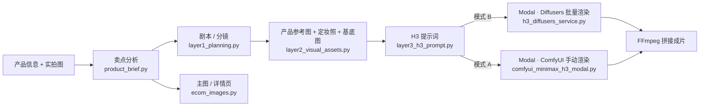

# AI 带货内容全链路流水线（Modal + MiniMax H3）

从「一款商品的信息和几张实拍图」出发，自动完成：卖点分析 → 带货短剧剧本与分镜 → 角色定妆照与产品参考图 → MiniMax H3 视频提示词 → 云端 GPU 渲染 → FFmpeg 拼接成片；同一份卖点分析还能生成电商主图和详情页。全部操作在一个本地 Gradio 网页里完成。

> 视频生成模型：**Powered by MiniMax H3**。模型权重受 [MiniMax H3 Community License](https://huggingface.co/MiniMaxAI/MiniMax-H3) 约束，有使用地域和商用限制，使用前请务必阅读本文末尾的「合规与许可」。

## 功能

- **卖点分析**：填写商品名称、类目、参数、目标人群、价格和真实背书，可粘贴买家评价 / 问大家 / 竞品卖点原文。LLM 提炼核心卖点、用户痛点、差异化、人群画像和使用场景。结果可直接修改，视频和图文都以它为准。只引用你填写的背书，不编造参数和认证。
- **类目手册**：按类目（宠物、母婴、保健食品、美妆护肤、食品饮料、3C 数码/家电、服饰鞋包、家居日用）调整卖点角度、剧本和图文要点、详情页屏序和类目合规词。从类目、商品名称和描述自动识别，也可手动选择。内置类目里没有的，可以让 AI 按同一套字段起草一份自定义手册，核对后保存复用；自定义手册继承最接近的内置类目的合规风险词，只能加不能减。
- **商用标准包**：「代用茶（莓茶 / 藤茶 / 花草茶）」和「宠物营养补充剂」两个类目单独做了一套可直接商用的标准：按法规列的包装标签必备项（代用茶按 GB 7718-2025，宠物营养补充剂按《宠物饲料标签规定》）、上传前的照片清单、按定位分的 15 屏详情页屏序、额外的类目风险词，以及「有机」「野生」「天然」、含量百分比等需要依据才能写的说法。其它类目以后按同样的方式加进 `pipeline/categories/`（一个类目一个文件，手册 + 主图 / 详情页生成策略放在一起），或写进自定义手册
- **产品定位**：同一产品在不同渠道打法不同。定位分「性价比 / 品质日常 / 高端礼赠」三档，决定详情页屏序、文案语气、画面方向和价格展示；默认跟随平台（拼多多 = 性价比，微信小店 / 视频号 = 高端礼赠，其余 = 品质日常），也可以在「📦 产品信息」页手动指定
- **剧本与分镜**：十套剧本模板，按视频类型分组：剧情带货、口播种草、产品展示、开箱测评、使用教程、产地 / 品牌故事、对比实验、节日营销。每种类型有自己的编导角色和创作规则；覆盖不到的场景可以逐行写自定义节拍（2–6 镜）。四个目标平台（抖音/快手、视频号、淘宝/京东主图视频、详情页视频）决定画幅、单镜时长、口播字数上限和推荐模板，选了不适合该平台的模板会提示。提示词里写明 H3 的能力边界（每镜独立渲染、镜内不切镜、画面不写字等），避免写出渲染不出来的剧本。默认注入项目自带的「短视频带货」编剧技能，也可加选其它技能。输出完整剧本、角色设定、场景设定和逐镜分镜。
- **人物与产品一致性**：每个角色生成一张定妆照，产品镜头所需的参考图（Ref1、Ref2…）由 AI 以你上传的实拍图为参考生成。有人物或产品入画的镜头自动走 H3 的 Ref2VA 模式，用参考图锁定长相和包装。
- **H3 提示词**：按 MiniMax 官方 `h3-prompt-writing` 规范逐镜生成，自动注入角色外貌、场景、前后镜衔接。写盘前校验 `<Picture N>` 标签与参考图数量一致、规范要求的段落齐全且顺序正确、口播原样放进 `<d>`、没有要求画面出现文字、时间点不超出镜头时长；不合格时把问题告诉模型重写。
- **评测集**：`pipeline/evals/` 里放了几款真实产品 × 平台 × 模板的用例。改提示词、模板或技能后跑一遍，对比硬校验问题数和 LLM 评分，而不是凭感觉判断。
- **两种渲染方式**：
  - 模式 B（推荐）：Modal 上的 Diffusers 服务，一键批量渲染所有镜头并自动拼接；已渲染的镜头会跳过，失败后再点一次只补失败的。
  - 模式 A：Modal 上的 ComfyUI，手动逐镜粘贴提示词渲染，适合精调单个镜头。
- **主图 / 详情页**：支持淘宝/天猫、拼多多、微信小店；主图 5 或 10 张（1:1 或 3:4），详情页 15 张。文字可选「程序叠字」（中文不会错，改字免费）或「AI 直接写字」。一键打包 zip。
- **质量检查**：
  - 输入体检：生成前提示还缺哪些信息（按类目列出必填项）。
  - 生成后硬校验：镜头数和节拍、口播字数、卖点是否都用上、文案重复、字数超限、广告法极限词和类目风险词，以及画面描述里暗示医疗场景或疗效的词（医院、医生、捂胸口、咳嗽等）。结果写在运行日志里。
  - 可选模型自检：让 LLM 按评分标准和程序发现的问题再改一轮。按严重程度计分（❌ 5 分、⚠️ 1 分），改稿新增任何 ❌ 或总分变差时保留初稿。会多一次 LLM 调用。
  - 主图 / 详情页生成后自动检查文字区背景是否太杂（不花钱）；可选让视觉模型核对主图里的产品包装文字、logo 和配色是否与实拍图一致。
  - 这些都是关键词和规则判断，只能拦住明显问题，不能替代人工和法务审核。

## 架构



LLM 和生图调用的是 [Right Code](https://www.right.codes/)（API 域名 `www.rightapi.ai`）的 OpenAI 兼容接口；视频渲染跑在你自己的 [Modal](https://modal.com/) 账号上。

## 目录结构

```
Modal_ComfyUI/
├── h3_diffusers_service.py       # 模式 B：Modal 上的 Diffusers 批量渲染服务
├── comfyui_minimax_h3_modal.py   # 模式 A：Modal 上的 ComfyUI（可选）
├── skills-lock.json              # h3-prompt-writing 技能的来源记录
├── requirements.txt              # 本地依赖（云端镜像依赖写在两个 Modal 脚本里）
├── LICENSE
├── .agents/skills/               # 技能目录（不随仓库分发，见「安装 H3 提示词规范」）
└── pipeline/
    ├── app_gradio.py             # Web 界面入口
    ├── ui_theme.py / ui_theme.css # 界面主题、样式和卡片小部件
    ├── product_brief.py          # 卖点分析
    ├── category_playbook.py      # 类目手册（类目识别、卖点角度、详情页屏序、类目合规词、自定义手册）
    ├── categories/               # 类目生成策略：一个类目一个文件（手册 + 主图 / 详情页出图逻辑）
    │   ├── base.py               #   Category 数据类：主图角色、素材规则、参考图说明、画面要求、图标
    │   ├── tea.py                #   代用茶（莓茶 / 藤茶 / 花草茶）
    │   ├── pet_supplement.py     #   宠物营养补充剂
    │   └── __init__.py           #   注册表 + 自动发现（放进来的文件自动生效）
    ├── category_packs.py         # 兼容层：老名字转发到 categories/（数据只在 categories/ 维护）
    ├── positioning.py            # 产品定位（性价比 / 品质日常 / 高端礼赠）与平台默认
    ├── asset_library.py          # 产品素材库：照片类型、质量分、按屏分配素材、拍法去重
    ├── quality_check.py          # 输入体检、生成后硬校验、广告法初筛、模型自检的评分标准
    ├── layer1_planning.py        # 层 1：视频类型、剧本模板与分镜
    ├── layer2_visual_assets.py   # 层 2：定妆照、基底图
    ├── layer3_h3_prompt.py       # 层 3：H3 提示词与结构校验
    ├── ecom_images.py            # 主图 / 详情页
    ├── html_render.py            # 主图 / 详情页的 HTML 模板排版（无头 Chromium 截图）
    ├── templates/ecom/           # 主图 / 详情页的 HTML/CSS 模板
    ├── skills/short-video-selling/ # 项目自带的短视频带货编剧技能（默认注入）
    ├── playbooks/                # 自定义类目手册（保存后自动创建）
    ├── evals/                    # 评测集：cases.json 用例 + run_eval.py
    ├── tests/                    # pytest 测试
    ├── .env.example              # 配置模板
    └── output/                   # 运行产物（已加入 .gitignore）
```

## 准备工作

| 项目 | 说明 |
| --- | --- |
| Python | 3.10 及以上；Gradio 5 或 6（作者在 Windows + Python 3.14 + Gradio 6 上使用） |
| FFmpeg | 需在 PATH 中。Windows：`winget install Gyan.FFmpeg`；macOS：`brew install ffmpeg`；Ubuntu：`sudo apt install ffmpeg`。用 `ffmpeg -version` 确认 |
| Right Code 账号 | 两个令牌：一个用于文本模型（LLM），一个用于画图（draw） |
| Modal 账号 | 用于云端 GPU 渲染，需要有可用额度或绑定付款方式 |
| 中文字体 | 主图/详情页「程序叠字」需要。Windows 和 macOS 一般自带；Linux 可安装 Noto Sans CJK 或文泉驿微米黑 |
| Chromium（Playwright） | 主图/详情页「程序叠字」的 HTML 模板排版需要，`pip install` 后运行 `python -m playwright install chromium` 下载 |
| Node.js（可选） | 只在用 `npx` 安装 H3 提示词规范时需要 |

## 安装

### 1. 克隆仓库并安装依赖

```bash
git clone https://github.com/tuolin2013/Modal_ComfyUI.git
cd Modal_ComfyUI

python -m venv .venv
# Windows
.venv\Scripts\activate
# macOS / Linux
source .venv/bin/activate

pip install -r requirements.txt
# 主图/详情页「程序叠字」用无头 Chromium 排版，需下载一次浏览器（约 150 MB）
python -m playwright install chromium
```

Linux 服务器若缺少 Chromium 的系统依赖，改用 `python -m playwright install --with-deps chromium`。装不了浏览器时，程序叠字会自动退回 Pillow 简版排版（没有角标、价格标签和参数表的样式）。

### 2. 配置令牌

```bash
# Windows
copy pipeline\.env.example pipeline\.env
# macOS / Linux
cp pipeline/.env.example pipeline/.env
```

编辑 `pipeline/.env`，至少填写两个令牌。`.env` 已被 `.gitignore` 忽略，请不要提交它。

| 变量 | 必填 | 默认值 | 说明 |
| --- | --- | --- | --- |
| `RIGHT_CODES_LLM_KEY` | 是 | | 文本模型令牌：卖点分析、剧本、H3 提示词、图文策划 |
| `RIGHT_CODES_DRAW_KEY` | 是 | | 画图令牌：产品参考图、定妆照、基底图、主图/详情页 |
| `PLANNING_MODEL` | 否 | `claude-opus-5-5` | 策划用的 LLM，必须是平台上可用的模型名 |
| `LLM_TIMEOUT` | 否 | `300` | 单次 LLM 请求超时（秒）。完整剧本常要 2 分钟以上 |
| `IMAGE_MODEL` | 否 | `gpt-image-2.5` | 定妆照 / 基底图模型 |
| `IMAGE_SIZE` | 否 | `1008x1792` | 兜底尺寸；正常由「目标平台」决定 |
| `ECOM_IMAGE_MODEL` | 否 | `gpt-image-2.5` | 主图 / 详情页模型 |
| `RIGHT_CODES_DRAW_URL` | 否 | `https://www.rightapi.ai/draw/v1` | 主图 / 详情页的异步画图接口 |
| `ECOM_CONCURRENCY` | 否 | `4` | 主图 / 详情页同时出几张（并行提交、各自轮询，每完成一张就显示）；平台报 429 限流时调小 |
| `ECOM_RENDERER` | 否 | `html` | 程序叠字的排版引擎：`html`（HTML/CSS 模板 + 无头 Chromium）或 `pil`（Pillow 简版） |
| `ECOM_CHECK_MODEL` | 否 | 同 `PLANNING_MODEL` | 视觉模型：素材库照片自动分类（含读取包装背面标签）和主图产品核对，必须支持图片输入 |
| `ECOM_FONT` / `ECOM_FONT_BOLD` | 否 | 自动查找 | 中文字体文件路径（.ttf / .ttc） |
| `COMFYUI_URL` | 否 | 空 | 模式 A 的 ComfyUI 地址；不填则界面不显示跳转按钮 |

> LLM 的 Base URL `https://www.rightapi.ai/v1` 写在 `layer1_planning.py`、`layer2_visual_assets.py`、`layer3_h3_prompt.py` 的 `RIGHT_CODES_BASE_URL` 中。想换成其他 OpenAI 兼容平台，修改这三处即可（模型名也要相应调整）。

### 3. 安装 H3 提示词规范（必需）

层 3 会读取 `.agents/skills/h3-prompt-writing/references/` 下的 `base-en.txt` 和 `ref-en.txt`（MiniMax 官方的 H3 提示词写作规范）。**文件缺失时不会报错，但提示词质量会明显下降。** 本仓库不附带这些文件，请任选一种方式获取：

方式一：用 `skills` CLI 按 `skills-lock.json` 安装

```bash
npx skills experimental_install
```

方式二：从官方仓库手动复制

```bash
git clone --depth 1 https://github.com/MiniMax-AI/MiniMax-H3.git _h3
# macOS / Linux
mkdir -p .agents/skills && cp -r _h3/skills/h3-prompt-writing .agents/skills/
# Windows PowerShell
New-Item -ItemType Directory -Force .agents\skills | Out-Null; Copy-Item -Recurse _h3\skills\h3-prompt-writing .agents\skills\
```

确认 `.agents/skills/h3-prompt-writing/references/base-en.txt` 存在后，可删除 `_h3` 目录。

**编剧技能（可选）**：`.agents/skills/` 下除 `h3-prompt-writing` 外的每个子目录（含 `SKILL.md`）都会出现在界面的「编剧技能」下拉框里，生成剧本时注入。你可以放入自己编写或有授权的技能。

### 4. 登录 Modal 并部署渲染服务（模式 B）

```bash
modal setup                                            # 浏览器登录，只需一次

modal run h3_diffusers_service.py::download_weights    # 下载 MiniMax-H3 权重到 Modal 卷（约 130 GB，耗时较长）
modal run h3_diffusers_service.py::verify_weights      # 按文件大小校验，几秒钟
modal run h3_diffusers_service.py::verify_weights --deep  # 可选：再比对 sha256，较慢
modal deploy h3_diffusers_service.py                   # 部署服务
modal app list                                         # 确认 minimax-h3-diffusers-service 为 deployed
```

- 权重存放在 Modal 卷 `minimax-h3-weights`，只需下载一次。下载中断可重新运行，已完成的文件会跳过，`verify_weights` 会修复不完整的文件。
- 服务使用 RTX-PRO-6000（96 GB）并开启 CPU offload。ref2va 组件合计约 130 GiB，A100-80GB 或关闭 offload 实测都会显存不足，修改 `GPU` / `CPU_OFFLOAD` 前请先确认显存。
- 容器空闲 2 分钟后自动关机，不渲染时不计 GPU 费用。查看日志：`modal app logs minimax-h3-diffusers-service`。

### 5. 部署 ComfyUI（模式 A，可选）

```bash
modal run comfyui_minimax_h3_modal.py::download_weights   # 下载 Comfy-Org 的 H3 量化权重
modal serve comfyui_minimax_h3_modal.py                   # 开发模式，终端里会打印 URL，Ctrl+C 停止
# 或长期部署：modal deploy comfyui_minimax_h3_modal.py
```

把打印出的地址写进 `pipeline/.env` 的 `COMFYUI_URL`。`modal serve` 的地址形如 `https://<你的用户名>--comfyui-minimax-h3-ui-dev.modal.run`，`modal deploy` 的地址没有 `-dev`。

> ⚠️ **ComfyUI 服务没有任何鉴权**，拿到 URL 的人都能使用你的 A100 并产生费用。建议只用 `modal serve` 临时开启、用完即停；`modal deploy` 后不用时执行 `modal app stop comfyui-minimax-h3`。如需鉴权可参考代码注释中的 `requires_proxy_auth`。

### 6. 启动界面

```bash
python pipeline/app_gradio.py
```

浏览器打开 <http://127.0.0.1:7860>。界面只监听本机，不会生成公网分享链接。

## 使用教程

### 第一步：产品信息与卖点（「📦 产品信息」页，视频和图文共用）

界面分三个页签：「📦 产品信息」→「🎬 带货视频」→「🖼️ 主图 / 详情页」。每一步的进度和结果都显示在右侧「运行日志」栏（可点边上的箭头收起）。界面默认深色，地址后加 `?__theme=light` 可切换浅色。

1. 在「① 填写产品信息」中填写商品名称、品牌主色、类目、产品描述 / 参数 / 特性，以及选填的目标人群、价格区间、真实背书。**文案只会引用「真实背书」里写的内容。**
   - 「买家评价 / 问大家 / 竞品卖点」可粘贴原文。它只用来提炼痛点和贴近买家的说法，不会被当作用户评价写进文案。
   - 「类目手册」默认自动识别，旁边显示识别结果；识别错了可手动选。代用茶和宠物营养补充剂会识别成商用标准包，「🩺 输入体检」会按法规列出包装标签还缺哪些项（如食品生产许可证、执行标准、成分分析保证值），并提示建议上传但还没拍的照片。
   - 「产品定位」默认跟随平台（拼多多 = 性价比，微信小店 / 视频号 = 高端礼赠）。同一个产品在不同渠道上架时，定位决定详情页屏序（性价比先讲份量和到手价，高端先讲品牌故事和产地、不放价格）、文案语气和整套图的画面方向；高端定位的主图价格由程序清掉。
   - 内置手册里没有你的类目：展开「➕ 新建 / 编辑自定义类目手册」，点「🤖 AI 起草」，核对买家关注点、必填信息和风险词后点「💾 保存并选用」。之后同类商品会自动识别到这份手册。
   - 点「🩺 输入体检」查看还缺哪些信息（不调用 LLM）。
2. 点「🔍 分析卖点」。右边「② 卖点分析」得到核心卖点（每行一个，按说服力排序）、用户痛点、差异化、目标人群画像、使用场景，可直接修改。不满意可再点一次重新分析。
3. 在「③ 产品素材库」一次拖入多张实拍照片（最多 20 张，手机随手拍和精修图都可以）：包装正面、包装背面（配料 / 标签）、产品本体（干茶、片剂）、使用中（茶汤、宠物进食）、叶底 / 质地、原料 / 产地、证书。上传后视觉模型自动识别每张的类型（每 6 张一次调用，模型由 `ECOM_CHECK_MODEL` 指定），包装背面的标签信息（配料、净含量、保质期、许可证号等）会被读出来，供规格参数屏使用；读出来的内容请在缩略图下核对。类型分错的直接改，手动改过的不会被重新识别覆盖。每张图还有本地算的质量分（清晰度、分辨率、是否白底，不调接口）。包装正面的照片用来锁定产品外观，剧本里的产品镜头和主图/详情页都以它为参考。

### 第二步：带货视频（「🎬 带货视频」页）

**① 剧本策划**

1. 选择目标平台和「视频类型 · 剧本模板」。平台决定画幅、单镜时长和口播字数上限；换平台时，当前模板不适合会自动切到推荐模板，手动选回不适合的模板会给出提示。模板都覆盖不到时选「✍️ 自定义节拍」，逐行填写「节拍名 | A-Roll 或 B-Roll | 这一镜的任务」。
2. 「编剧技能」默认选中项目自带的 `short-video-selling`（钩子、口播、结构、平台差异、常见翻车点）。长剧和舞台类技能篇幅大，会稀释带货重点，按需加选；勾选「同时注入技能参考资料」更贴合技法，但更耗 token。
3. 「先出 3 个创意方向」默认勾选：模型先只想创意（切入角度、第一镜画面和口播、全片冲突、结尾回报），自评后选一个，再按它展开分镜。选中的方向有合规风险时，程序改选无风险方向里分数最高的。3 个方向都列在运行日志里。多一次 LLM 调用。
4. 可选：勾选「生成后让模型按评分标准自检并修改一轮」，耗时和 token 约翻倍。
5. 点「1️⃣ 生成分镜脚本」。运行日志会列出剧本检查结果（节拍、口播字数、卖点覆盖、合规）。完成后在右边「📜 剧本」页查看完整剧本、角色和场景设定，在「🎞️ 分镜脚本」页查看逐镜卡片。

> 重新生成分镜会清空上一版的产品参考图、定妆照、H3 提示词和镜头视频。

**② 素材准备**

1. 左侧列出剧本需要的产品镜头图（Ref1、Ref2…）及用途，可点「🤖 现在生成」单独生成，不满意点「🔄 重新生成」。
2. 点「2️⃣ 生成定妆照 + 基底图」。依次完成：补齐缺失的产品参考图 → 生成每个角色的定妆照 → 生成每镜基底图 → 自动生成全部 H3 提示词。基底图提示词由程序拼接：风格（产品特写用棚拍，人物和生活镜头用生活纪实）+ 画幅 + 场景设定原文 + 出场角色外貌原文 + 这一镜的动作和构图，镜头之间的场景和人物不会因模型改写而漂移。
3. 到「📜 剧本」页检查定妆照。可点「🔄 重新生成定妆照」，或上传真人模特照替换（**须取得本人授权**）。
4. 「草图模式」使用 nano-banana-2-lite，又快又便宜（固定 1:1），适合先验证构图。

**③ 渲染与合成**

- **模式 B（推荐）**：点「🚀 批量渲染并自动拼接」。镜头按顺序逐个在 Modal 上渲染，完成后自动拼接，成片在「🍿 成片」页播放。已有视频的镜头会跳过；某个镜头失败时再点一次只补失败的。勾选「全部重新渲染」则忽略已有视频。
- **模式 A**：在「🎞️ 分镜脚本」页逐镜（或在「📋 全部 H3 提示词」中一次性）复制提示词，打开「🛠️ 模式 A：单镜手动生成」里的 ComfyUI 页面，粘贴到 MiniMax H3 节点。参考图按卡片上的 Picture 编号顺序接入（顺序错了人物和产品会对调），种子填卡片上给出的统一种子。渲染结果命名为 `shot_01.mp4`、`shot_02.mp4`… 放进 `pipeline/output/videos/`，再点「4️⃣ 拼接本地已有的镜头视频」。

> 拼接使用 `ffmpeg -c copy`，不重新编码，所有镜头需同分辨率、同编码参数，否则可能失败或花屏。

### 第三步：主图 / 详情页（「🖼️ 主图 / 详情页」页）

1. **① 规格设置**：选择电商平台、主图张数（5 / 10）和比例（1:1 = 1440×1440，3:4 = 1440×1920）；详情页固定 15 张 3:4。可选是否让视频里的定妆照模特出镜。
2. **② 策划与生成**：
   - 点「① 策划图文」，LLM 为每张图写结构化文案（标题、副标题、卖点标签、角标、价格标签、参数表）和画面描述，并给整套图定一个版式主色和一份视觉设定（主光、台面材质、固定道具、镜头质感），视觉设定会拼进每一张图的提示词，让整套图像同一组拍摄。详情页 15 屏的屏序按类目手册调整（如宠物类有「喂养方法」「适用对象」屏）。可勾选「策划后让模型按评分标准自检并修改一轮」。运行日志列出图文检查结果。右边每张卡片的文案都可以在生成前直接修改。
   - 详情页每屏有一个版式：标准（标题 + 正文 + 要点 / 参数表）、流程步骤、卖点图标网格、对比表（每行「对比项｜普通做法｜本品」，不点名竞品）。策划时 LLM 按内容挑选，卡片上可以改。信息图由程序画，文字准确、改字免费；它要求更大的顶部留白，所以从标准版式改成信息图后建议点「重新生成画面」。场景图按目标人群写具体的地点、时间和道具，人物镜头用生活纪实风格（不是影棚光），让买家有代入感。
   - 素材自动分配：策划前程序按每屏的作用（产地、冲泡、叶底、资质、规格……）从素材库里挑最合适的照片（类型匹配 + 质量，同一张图最多用 3 屏、相邻屏不重复），并决定出图方式：
     - 实拍直出：这屏要的就是证据（茶汤、叶底、原料、证书、包装背面）且照片够清楚，直接用照片排版，不调生图接口、不花钱；
     - 参考重绘：需要新构图，以包装正面锁定外观、内容照片作素材参考生成；
     - 纯生成：不出现产品的氛围屏（如痛点）。
     每屏还会分到一种拍法（正面主体、45° 桌面、俯拍平铺、微距、侧光、第一人称手持、生活场景、环境远景），相邻屏不重复，避免 15 屏雷同。卡片上显示这屏用了哪张素材，可以手动换照片、出图方式和拍法。缺对口照片时运行日志会提示补拍哪一类；补拍或改了照片类型后点「🔁 重新分配素材」，文案不变，手动指定过的屏保持不变，下次生成只重出有变化的屏。只有实拍直出的屏能在文案里写「实拍」「产地实景」，其它屏这样写会被检查标为违规。
   - 选择文字上图方式：「程序叠字」中文不会错、改字只重排不花钱，由 `pipeline/templates/ecom/` 下的 HTML/CSS 模板排版，文字过长时自动缩小，仍放不下会在卡片上给出排版提示；「AI 直接写字」设计感更强，但可能错字漏字，改字要重新生成画面。
   - 价格标签填数字（模板自动加 ¥）或【占位】。
   - 策划后先核对每张卡片用了哪张参考照片（主图和详情页都会从素材库分配）。原料产地、冲泡、叶底、证书这类画面主体是真实内容的屏，素材库里没有对口照片时卡片会标「缺实拍」，补拍前不出图，免得 AI 凭空画；直接在卡片上点「📷 上传这屏的参考照片」即可，也可以手动选出图方式。
   - 点「② 生成全部图片」。同时出 `ECOM_CONCURRENCY` 张（默认 4），每完成一张卡片就显示出来，生成过程中改的文案不会被刷掉。策划后补拍、删图或改了照片类型，生成前会自动重新分配素材（手动指定过的屏不动）。默认只生成还没有底图的，勾选「全部重新生成画面」则全部重做。文字区背景太杂时卡片上会提示重新生成画面。可勾选「生成后让视觉模型核对主图里的产品」，每张主图多一次调用，结论显示在卡片上（只是辅助，上架前仍需人工核对包装）。
   - 单张图可「💾 保存文字并重排」或「🔄 重新生成画面」。还没有底图时，「💾」只保存文案，生成时生效。
3. **③ 导出**：点「📦 打包下载全部成品」，zip 同时保存在 `pipeline/output/ecom/exports/`。做下一个产品前点「🧹 清空，开始新产品」，会清掉本页策划、底图、成品和产品素材库，保留已打包的 zip 和「📦 产品信息」页的文字。

### 评测：改提示词或技能前后对比

```bash
cd pipeline
python -m evals.run_eval                    # 全部用例：生成剧本 + 硬校验（每条 1 次 LLM 调用）
python -m evals.run_eval --judge            # 再加 LLM 按评分标准打分（每条多 1 次调用）
python -m evals.run_eval --no-skill --judge # 不注入带货技能，用来对比技能本身的作用
python -m evals.run_eval --case berry-tea-douyin --self-review
python -m evals.run_eval --ecom             # 主图 / 详情页：同一产品在拼多多 / 微信小店的定位、屏序和合规（不生图）
```

用例在 `pipeline/evals/cases.json`（猫静宝、张家界莓茶 × 不同平台和模板），可以按同样格式加入自己的产品，只写真实信息。结果写入 `pipeline/evals/results/`，终端打印每条用例的 ❌/⚠️ 数、评分和用时。看多条用例的平均变化，不看单条；每次评测都会产生 LLM 费用。


### 产物位置

| 路径 | 内容 |
| --- | --- |
| `pipeline/output/product_brief.json` | 产品信息与卖点分析 |
| `pipeline/output/storyboard.json` | 剧本、分镜、角色、场景、参考图记录 |
| `pipeline/output/user_product_refs/` | 剧本所需的产品参考图 |
| `pipeline/output/assets/characters/` | 角色定妆照 |
| `pipeline/output/assets/shots/`、`shots_draft/` | 每镜基底图（精图 / 草图） |
| `pipeline/output/prompts/shot_XX_h3_prompt.txt` | 每镜 H3 提示词 |
| `pipeline/output/videos/shot_XX.mp4` | 单镜视频 |
| `pipeline/output/videos/final_commercial.mp4` | 拼接成片 |
| `pipeline/output/ecom/` | 主图 / 详情页的策划、底图、成品和导出 zip |

## 费用与耗时（参考）

以下为作者 2026-10-10 在 Modal RTX-PRO-6000（约 $3.03/小时）+ CPU offload、30 步采样下的实测，仅供估算，价格以 Modal 官网为准：

| 场景 | 单镜渲染时间 | 单镜 GPU 费用 |
| --- | --- | --- |
| Ref2VA，2 张参考图，约 5 秒 | 约 14 分钟（27.5 秒/步） | 约 $1.0 |
| Ref2VA，1 张参考图，约 5 秒 | 约 9.5 分钟 | 约 $0.7 |

一条 4 镜成片的 GPU 费用约 $4，另加冷启动和模型加载时间。界面上「每镜约 6 分钟」的提示偏乐观。LLM 和生图费用按 Right Code 的计价另算。Modal 卷存储权重也可能产生费用。

## 已知限制

- H3 单镜帧数须为 17n+5 且在 124–345 帧之间，即每镜约 5.2–14.4 秒。分镜时长按平台限制（如抖音/快手 5–6 秒、视频号 6–8 秒）；口播太长时会按字数拉长，最长 14 秒，并在剧本检查里提示。
- 每镜口播字数上限按平台时长换算（约 4 字/秒），过长会被截断。
- 画幅按所选平台传给 H3：9:16 → 768×1344，1:1 → 768×768，16:9 → 1344×768（短边 768，H3 默认画布）。升级后请重新部署 `modal deploy h3_diffusers_service.py`；修复前渲染的 16:9 镜头在下次渲染时会自动作废重渲。
- 类目手册和质量检查都是关键词与规则判断：卖点覆盖按字面重合粗判（换了说法可能误报），类目合规词只覆盖常见风险，不能替代人工和法务审核。AI 起草的自定义手册同样只是草稿，风险词需要人工核对。
- 商用标准包的标签必备项按 GB 7718-2025（2027-03-16 起实施，此前可提前执行）和《宠物饲料标签规定》（农业农村部公告第 20 号）整理，只按字面查「写没写」，不查写得对不对；宠物营养补充剂的「预防毛球 / 牙垢」这类非疾病问题允许声称，但初筛仍会标出「预防」，请人工确认。上线前请法务或类目专家核对。
- 素材库的照片分类靠视觉模型，可能分错，请在缩略图下核对；清晰度质量分的阈值是经验值，样本不多。包装背面读出的标签信息必须人工核对后再用。
- 视频类型由模板覆盖：长口播、多机位访谈、画中画、带字幕花字的成片做不了（H3 每镜 5–14 秒独立渲染，画面里写不出正确的中文），字幕和价格信息需要后期剪辑加。
- 评测集的 LLM 评分只是相对参考，同一份提示词两次跑的分数也会波动；它不能代替真实投放的完播率和转化数据。
- 基底图 / 定妆照按精确画幅请求自定义尺寸（9:16 → 1008×1792，16:9 → 1792×1008）。平台不接受时自动改用 1024×1536 / 1536×1024 重试；这个回退在真实接口上还没有验证过。
- 文字区「背景较杂」按边缘密度判断，阈值根据少量样图定的，可能误报（如木纹台面）或漏报（如低对比的物体）。产品核对依赖视觉模型，可能漏看小字。
- 模式 B 逐镜串行渲染，不并发。
- 纯文生视频（T2VA）路径的实测较少；目前剧本中有人物或产品的镜头都会走 Ref2VA。
- `diffusers` 跟随 main 分支安装，渲染镜像中的其他依赖也未锁版本，上游更新可能导致构建或推理失败。
- 启动时不检查令牌是否填写，缺失时会在第一次调用接口时报 401。

## 常见问题

**提示「找不到 Modal 应用」**
先执行 `modal deploy h3_diffusers_service.py`，再用 `modal app list` 确认 `minimax-h3-diffusers-service` 处于 deployed 状态；本地 `modal setup` 登录的账号要与部署账号一致。

**提示「未找到 ffmpeg」**
安装 FFmpeg 并加入 PATH，重新打开终端后用 `ffmpeg -version` 确认。

**提示「未找到中文字体」**
在 `pipeline/.env` 中设置 `ECOM_FONT` / `ECOM_FONT_BOLD` 为字体文件的完整路径。

**卡片上显示「程序叠字（简版排版）」/「已退回简版排版：Chromium 无法启动」**
没有下载 Chromium 或缺系统依赖。运行 `python -m playwright install chromium`（Linux 加 `--with-deps`）后重启界面，再点「💾 保存文字并重排」。

**生成分镜超时（ReadTimeout）**
完整剧本输出较长，可在 `.env` 中调大 `LLM_TIMEOUT`（例如 600）后重试。

**Modal 渲染报显存不足（OOM）**
保持 `CPU_OFFLOAD=True`，不要换成显存更小的 GPU。

**H3 提示词质量差，或 Ref2VA 人物 / 产品错位**
检查 `.agents/skills/h3-prompt-writing/references/` 是否存在。已生成的提示词会被缓存复用，删除 `pipeline/output/prompts/` 中对应的 `shot_XX_h3_prompt.txt` 后，再点 2️⃣ 或「🚀 批量渲染」会自动重新生成。

**下载权重时出现 Hugging Face 未认证警告**
可忽略，不影响下载。

## 合规与许可

**本仓库代码**以 [MIT License](LICENSE) 开源。MIT 许可只覆盖本仓库的代码，不覆盖 MiniMax H3 模型、第三方节点和你调用的任何外部服务。

**MiniMax H3 模型**由使用者自行从 Hugging Face 下载，适用 [MiniMax H3 Community License](https://huggingface.co/MiniMaxAI/MiniMax-H3)。按作者对 2026-08-02 版许可的理解，要点包括：

- 授权仅在「适用地区」有效，即全球**除欧盟、英国、韩国和美国以外**的地区；许可同时限制在这些地区之外使用、复制、分享或展示模型**及其输出**。
- 年收入超过 2,000 万美元的商用需取得 MiniMax 书面许可。
- 基于 H3 的产品或服务需醒目标注「MiniMax H3」。
- 不得用模型输出改进其他 AI 模型。
- 使用政策禁止未经同意冒用他人肖像、发布未披露的 AI 内容等。

需要注意：Modal 默认会在其全球资源池中调度容器，可能运行在美国。Modal 支持通过 `region=` 参数指定运行区域（会产生额外费用），本项目代码**没有**设置该参数，请根据许可要求自行评估和配置。以上不构成法律意见，如有商业用途请咨询律师，或通过 [MiniMax 授权申请页](https://platform.minimax.io/h3-license) 联系官方。

**发布内容时**：

- 中国《人工智能生成合成内容标识办法》自 2025-09-01 起施行，发布 AI 生成的视频和图片需按平台要求标识。
- 内置的广告法检查只是关键词预检，不能替代人工审核和平台审核。
- AI 生成的产品图可能改变包装文字、logo 或细节，上线前请与实物逐项核对。
- 上传真人照片作为定妆照前，须取得本人授权。

## 致谢

- [MiniMax H3](https://github.com/MiniMax-AI/MiniMax-H3) 及其 `h3-prompt-writing` 提示词规范
- [Hugging Face Diffusers](https://github.com/huggingface/diffusers)
- [Modal](https://modal.com/)
- [Gradio](https://www.gradio.app/)
- [ComfyUI](https://github.com/comfyanonymous/ComfyUI)，以及节点 [ComfyUI-ALLinONE-MinimaxH3](https://github.com/LeonQ8/ComfyUI-ALLinONE-MinimaxH3)、[ComfyUI-KJNodes](https://github.com/kijai/ComfyUI-KJNodes)、[ComfyUI-Manager](https://github.com/ltdrdata/ComfyUI-Manager)、[comfyui-vrgamedevgirl](https://github.com/vrgamegirl19/comfyui-vrgamedevgirl)
- [Right Code](https://www.right.codes/)
