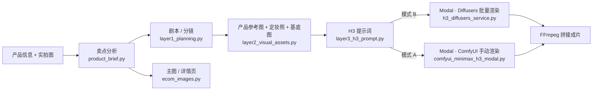

# AI 带货内容全链路流水线（Modal + MiniMax H3）

从「一款商品的信息和几张实拍图」出发，自动完成：卖点分析 → 带货短剧剧本与分镜 → 角色定妆照与产品参考图 → MiniMax H3 视频提示词 → 云端 GPU 渲染 → FFmpeg 拼接成片；同一份卖点分析还能生成电商主图和详情页。全部操作在一个本地 Gradio 网页里完成。

> 视频生成模型：**Powered by MiniMax H3**。模型权重受 [MiniMax H3 Community License](https://huggingface.co/MiniMaxAI/MiniMax-H3) 约束，有使用地域和商用限制，使用前请务必阅读本文末尾的「合规与许可」。

## 功能

- **卖点分析**：填写商品名称、类目、参数、目标人群、价格和真实背书，LLM 提炼核心卖点、用户痛点、差异化、人群画像和使用场景。结果可直接修改，视频和图文都以它为准。只引用你填写的背书，不编造参数和认证。
- **剧本与分镜**：内置三套剧本模板（经典反转 4 镜、痛点-解决 5 镜、种草分享 5 镜）和四个目标平台（抖音/快手、视频号、淘宝/京东主图视频、详情页视频），可选注入自定义的编剧技能。输出完整剧本、角色设定、场景设定和逐镜分镜。
- **人物与产品一致性**：每个角色生成一张定妆照，产品镜头所需的参考图（Ref1、Ref2…）由 AI 以你上传的实拍图为参考生成。有人物或产品入画的镜头自动走 H3 的 Ref2VA 模式，用参考图锁定长相和包装。
- **H3 提示词**：按 MiniMax 官方 `h3-prompt-writing` 规范逐镜生成，自动注入角色外貌、场景、前后镜衔接，并校验 `<Picture N>` 标签与参考图数量一致。
- **两种渲染方式**：
  - 模式 B（推荐）：Modal 上的 Diffusers 服务，一键批量渲染所有镜头并自动拼接；已渲染的镜头会跳过，失败后再点一次只补失败的。
  - 模式 A：Modal 上的 ComfyUI，手动逐镜粘贴提示词渲染，适合精调单个镜头。
- **主图 / 详情页**：支持淘宝/天猫、拼多多、微信小店；主图 5 或 10 张（1:1 或 3:4），详情页 15 张。文字可选「程序叠字」（中文不会错，改字免费）或「AI 直接写字」。一键打包 zip。
- **广告法预检**：卖点、口播和图文文案会做极限词/敏感词关键词预检。

## 架构



LLM 和生图调用的是 [Right Code](https://www.right.codes/)（API 域名 `www.rightapi.ai`）的 OpenAI 兼容接口；视频渲染跑在你自己的 [Modal](https://modal.com/) 账号上。

## 目录结构

```
Modal_ComfyUI/
├── h3_diffusers_service.py       # 模式 B：Modal 上的 Diffusers 批量渲染服务
├── comfyui_minimax_h3_modal.py   # 模式 A：Modal 上的 ComfyUI（可选）
├── skills-lock.json              # h3-prompt-writing 技能的来源记录
├── requirements.txt              # 本地依赖（云端镜像依赖写在两个 Modal 脚本里）
├── LICENSE
├── .agents/skills/               # 技能目录（不随仓库分发，见「安装 H3 提示词规范」）
└── pipeline/
    ├── app_gradio.py             # Web 界面入口
    ├── product_brief.py          # 卖点分析
    ├── layer1_planning.py        # 层 1：剧本与分镜
    ├── layer2_visual_assets.py   # 层 2：定妆照、基底图
    ├── layer3_h3_prompt.py       # 层 3：H3 提示词
    ├── ecom_images.py            # 主图 / 详情页
    ├── .env.example              # 配置模板
    └── output/                   # 运行产物（已加入 .gitignore）
```

## 准备工作

| 项目 | 说明 |
| --- | --- |
| Python | 3.10 及以上；Gradio 5 或 6（作者在 Windows + Python 3.14 + Gradio 6 上使用） |
| FFmpeg | 需在 PATH 中。Windows：`winget install Gyan.FFmpeg`；macOS：`brew install ffmpeg`；Ubuntu：`sudo apt install ffmpeg`。用 `ffmpeg -version` 确认 |
| Right Code 账号 | 两个令牌：一个用于文本模型（LLM），一个用于画图（draw） |
| Modal 账号 | 用于云端 GPU 渲染，需要有可用额度或绑定付款方式 |
| 中文字体 | 主图/详情页「程序叠字」需要。Windows 和 macOS 一般自带；Linux 可安装 Noto Sans CJK 或文泉驿微米黑 |
| Node.js（可选） | 只在用 `npx` 安装 H3 提示词规范时需要 |

## 安装

### 1. 克隆仓库并安装依赖

```bash
git clone https://github.com/tuolin2013/Modal_ComfyUI.git
cd Modal_ComfyUI

python -m venv .venv
# Windows
.venv\Scripts\activate
# macOS / Linux
source .venv/bin/activate

pip install -r requirements.txt
```

### 2. 配置令牌

```bash
# Windows
copy pipeline\.env.example pipeline\.env
# macOS / Linux
cp pipeline/.env.example pipeline/.env
```

编辑 `pipeline/.env`，至少填写两个令牌。`.env` 已被 `.gitignore` 忽略，请不要提交它。

| 变量 | 必填 | 默认值 | 说明 |
| --- | --- | --- | --- |
| `RIGHT_CODES_LLM_KEY` | 是 | | 文本模型令牌：卖点分析、剧本、H3 提示词、图文策划 |
| `RIGHT_CODES_DRAW_KEY` | 是 | | 画图令牌：产品参考图、定妆照、基底图、主图/详情页 |
| `PLANNING_MODEL` | 否 | `claude-opus-5-5` | 策划用的 LLM，必须是平台上可用的模型名 |
| `LLM_TIMEOUT` | 否 | `300` | 单次 LLM 请求超时（秒）。完整剧本常要 2 分钟以上 |
| `IMAGE_MODEL` | 否 | `gpt-image-2.5` | 定妆照 / 基底图模型 |
| `IMAGE_SIZE` | 否 | `1024x1792` | 兜底尺寸；正常由「目标平台」决定 |
| `ECOM_IMAGE_MODEL` | 否 | `gpt-image-2.5` | 主图 / 详情页模型 |
| `RIGHT_CODES_DRAW_URL` | 否 | `https://www.rightapi.ai/draw/v1` | 主图 / 详情页的异步画图接口 |
| `ECOM_FONT` / `ECOM_FONT_BOLD` | 否 | 自动查找 | 中文字体文件路径（.ttf / .ttc） |
| `COMFYUI_URL` | 否 | 空 | 模式 A 的 ComfyUI 地址；不填则界面不显示跳转按钮 |

> LLM 的 Base URL `https://www.rightapi.ai/v1` 写在 `layer1_planning.py`、`layer2_visual_assets.py`、`layer3_h3_prompt.py` 的 `RIGHT_CODES_BASE_URL` 中。想换成其他 OpenAI 兼容平台，修改这三处即可（模型名也要相应调整）。

### 3. 安装 H3 提示词规范（必需）

层 3 会读取 `.agents/skills/h3-prompt-writing/references/` 下的 `base-en.txt` 和 `ref-en.txt`（MiniMax 官方的 H3 提示词写作规范）。**文件缺失时不会报错，但提示词质量会明显下降。** 本仓库不附带这些文件，请任选一种方式获取：

方式一：用 `skills` CLI 按 `skills-lock.json` 安装

```bash
npx skills experimental_install
```

方式二：从官方仓库手动复制

```bash
git clone --depth 1 https://github.com/MiniMax-AI/MiniMax-H3.git _h3
# macOS / Linux
mkdir -p .agents/skills && cp -r _h3/skills/h3-prompt-writing .agents/skills/
# Windows PowerShell
New-Item -ItemType Directory -Force .agents\skills | Out-Null; Copy-Item -Recurse _h3\skills\h3-prompt-writing .agents\skills\
```

确认 `.agents/skills/h3-prompt-writing/references/base-en.txt` 存在后，可删除 `_h3` 目录。

**编剧技能（可选）**：`.agents/skills/` 下除 `h3-prompt-writing` 外的每个子目录（含 `SKILL.md`）都会出现在界面的「编剧技能」下拉框里，生成剧本时注入。你可以放入自己编写或有授权的技能。

### 4. 登录 Modal 并部署渲染服务（模式 B）

```bash
modal setup                                            # 浏览器登录，只需一次

modal run h3_diffusers_service.py::download_weights    # 下载 MiniMax-H3 权重到 Modal 卷（约 130 GB，耗时较长）
modal run h3_diffusers_service.py::verify_weights      # 按文件大小校验，几秒钟
modal run h3_diffusers_service.py::verify_weights --deep  # 可选：再比对 sha256，较慢
modal deploy h3_diffusers_service.py                   # 部署服务
modal app list                                         # 确认 minimax-h3-diffusers-service 为 deployed
```

- 权重存放在 Modal 卷 `minimax-h3-weights`，只需下载一次。下载中断可重新运行，已完成的文件会跳过，`verify_weights` 会修复不完整的文件。
- 服务使用 RTX-PRO-6000（96 GB）并开启 CPU offload。ref2va 组件合计约 130 GiB，A100-80GB 或关闭 offload 实测都会显存不足，修改 `GPU` / `CPU_OFFLOAD` 前请先确认显存。
- 容器空闲 2 分钟后自动关机，不渲染时不计 GPU 费用。查看日志：`modal app logs minimax-h3-diffusers-service`。

### 5. 部署 ComfyUI（模式 A，可选）

```bash
modal run comfyui_minimax_h3_modal.py::download_weights   # 下载 Comfy-Org 的 H3 量化权重
modal serve comfyui_minimax_h3_modal.py                   # 开发模式，终端里会打印 URL，Ctrl+C 停止
# 或长期部署：modal deploy comfyui_minimax_h3_modal.py
```

把打印出的地址写进 `pipeline/.env` 的 `COMFYUI_URL`。`modal serve` 的地址形如 `https://<你的用户名>--comfyui-minimax-h3-ui-dev.modal.run`，`modal deploy` 的地址没有 `-dev`。

> ⚠️ **ComfyUI 服务没有任何鉴权**，拿到 URL 的人都能使用你的 A100 并产生费用。建议只用 `modal serve` 临时开启、用完即停；`modal deploy` 后不用时执行 `modal app stop comfyui-minimax-h3`。如需鉴权可参考代码注释中的 `requires_proxy_auth`。

### 6. 启动界面

```bash
python pipeline/app_gradio.py
```

浏览器打开 <http://127.0.0.1:7860>。界面只监听本机，不会生成公网分享链接。

## 使用教程

### 第一步：产品信息与卖点（页面顶部，视频和图文共用）

1. 展开「📦 产品信息与卖点」，填写商品名称、品牌主色、类目、产品描述 / 参数 / 特性，以及选填的目标人群、价格区间、真实背书。**文案只会引用「真实背书」里写的内容。**
2. 点「🔍 分析卖点」。右侧得到核心卖点（每行一个，按说服力排序）、用户痛点、差异化、目标人群画像、使用场景，可直接修改。不满意可再点一次重新分析。
3. 展开「📸 产品实拍图」，上传最多 3 张不同角度的实拍图，并在旁边写上角度说明（如「正面平视，白底」「侧面 45°」「细节特写」）。剧本里的产品镜头和主图/详情页都以这些图为参考生成，图越清晰，包装文字和 logo 还原越好。

### 第二步：带货视频（「🎬 带货视频」页）

**① 剧本策划**

1. 选择剧本模板和目标平台（平台决定画幅和剧本节奏）。
2. 可选：在「编剧技能」中多选技能；勾选「同时注入技能参考资料」更贴合技法，但更耗 token。
3. 点「1️⃣ 生成分镜脚本」。完成后在右侧「📜 剧本」页查看完整剧本、角色和场景设定，在「🎞️ 分镜脚本」页查看逐镜卡片。

> 重新生成分镜会清空上一版的产品参考图、定妆照、H3 提示词和镜头视频。

**② 素材准备**

1. 左侧列出剧本需要的产品镜头图（Ref1、Ref2…）及用途，可点「🤖 现在生成」单独生成，不满意点「🔄 重新生成」。
2. 点「2️⃣ 生成定妆照 + 基底图」。依次完成：补齐缺失的产品参考图 → 生成每个角色的定妆照 → 生成每镜基底图 → 自动生成全部 H3 提示词。
3. 到「📜 剧本」页检查定妆照。可点「🔄 重新生成定妆照」，或上传真人模特照替换（**须取得本人授权**）。
4. 「草图模式」使用 nano-banana-2-lite，又快又便宜（固定 1:1），适合先验证构图。

**③ 渲染与合成**

- **模式 B（推荐）**：点「🚀 批量渲染并自动拼接」。镜头按顺序逐个在 Modal 上渲染，完成后自动拼接，成片在「🍿 成片」页播放。已有视频的镜头会跳过；某个镜头失败时再点一次只补失败的。勾选「全部重新渲染」则忽略已有视频。
- **模式 A**：在「🎞️ 分镜脚本」页逐镜（或在「📋 全部 H3 提示词」中一次性）复制提示词，打开「🛠️ 模式 A：单镜手动生成」里的 ComfyUI 页面，粘贴到 MiniMax H3 节点。参考图按卡片上的 Picture 编号顺序接入（顺序错了人物和产品会对调），种子填卡片上给出的统一种子。渲染结果命名为 `shot_01.mp4`、`shot_02.mp4`… 放进 `pipeline/output/videos/`，再点「4️⃣ 拼接本地已有的镜头视频」。

> 拼接使用 `ffmpeg -c copy`，不重新编码，所有镜头需同分辨率、同编码参数，否则可能失败或花屏。

### 第三步：主图 / 详情页（「🖼️ 主图 / 详情页」页）

1. **① 规格设置**：选择电商平台、主图张数（5 / 10）和比例（1:1 = 1440×1440，3:4 = 1440×1920）；详情页固定 15 张 3:4。可选是否让视频里的定妆照模特出镜。
2. **③ 策划与生成**：
   - 点「① 策划图文」，LLM 为每张图写文案和画面描述，可在卡片中修改。
   - 选择文字上图方式：「程序叠字」中文不会错、改字只重排不花钱；「AI 直接写字」设计感更强，但可能错字漏字，改字要重新生成画面。
   - 点「② 生成全部图片」。默认只生成还没有底图的，勾选「全部重新生成画面」则全部重做。
   - 单张图可「💾 保存文字并重排」或「🔄 重新生成画面」。
3. **④ 导出**：点「📦 打包下载全部成品」，zip 同时保存在 `pipeline/output/ecom/exports/`。做下一个产品前点「🧹 清空，开始新产品」，会清掉本页策划、底图、成品和产品图，保留已打包的 zip 和顶部产品信息。

### 产物位置

| 路径 | 内容 |
| --- | --- |
| `pipeline/output/product_brief.json` | 产品信息与卖点分析 |
| `pipeline/output/storyboard.json` | 剧本、分镜、角色、场景、参考图记录 |
| `pipeline/output/user_product_refs/` | 剧本所需的产品参考图 |
| `pipeline/output/assets/characters/` | 角色定妆照 |
| `pipeline/output/assets/shots/`、`shots_draft/` | 每镜基底图（精图 / 草图） |
| `pipeline/output/prompts/shot_XX_h3_prompt.txt` | 每镜 H3 提示词 |
| `pipeline/output/videos/shot_XX.mp4` | 单镜视频 |
| `pipeline/output/videos/final_commercial.mp4` | 拼接成片 |
| `pipeline/output/ecom/` | 主图 / 详情页的策划、底图、成品和导出 zip |

## 费用与耗时（参考）

以下为作者 2026-10-10 在 Modal RTX-PRO-6000（约 $3.03/小时）+ CPU offload、30 步采样下的实测，仅供估算，价格以 Modal 官网为准：

| 场景 | 单镜渲染时间 | 单镜 GPU 费用 |
| --- | --- | --- |
| Ref2VA，2 张参考图，约 5 秒 | 约 14 分钟（27.5 秒/步） | 约 $1.0 |
| Ref2VA，1 张参考图，约 5 秒 | 约 9.5 分钟 | 约 $0.7 |

一条 4 镜成片的 GPU 费用约 $4，另加冷启动和模型加载时间。界面上「每镜约 6 分钟」的提示偏乐观。LLM 和生图费用按 Right Code 的计价另算。Modal 卷存储权重也可能产生费用。

## 已知限制

- H3 单镜帧数须为 17n+5 且在 124–345 帧之间，即每镜约 5.2–14.4 秒；分镜时长会被限制在 5–14 秒。
- 每镜口播建议不超过 18 个字，过长会被截断。
- 画幅尚未显式传给 H3，成片分辨率和画幅以模型实际输出为准（实测 768p），可能与所选平台不完全一致。
- 模式 B 逐镜串行渲染，不并发。
- 纯文生视频（T2VA）路径的实测较少；目前剧本中有人物或产品的镜头都会走 Ref2VA。
- `diffusers` 跟随 main 分支安装，渲染镜像中的其他依赖也未锁版本，上游更新可能导致构建或推理失败。
- 启动时不检查令牌是否填写，缺失时会在第一次调用接口时报 401。

## 常见问题

**提示「找不到 Modal 应用」**
先执行 `modal deploy h3_diffusers_service.py`，再用 `modal app list` 确认 `minimax-h3-diffusers-service` 处于 deployed 状态；本地 `modal setup` 登录的账号要与部署账号一致。

**提示「未找到 ffmpeg」**
安装 FFmpeg 并加入 PATH，重新打开终端后用 `ffmpeg -version` 确认。

**提示「未找到中文字体」**
在 `pipeline/.env` 中设置 `ECOM_FONT` / `ECOM_FONT_BOLD` 为字体文件的完整路径。

**生成分镜超时（ReadTimeout）**
完整剧本输出较长，可在 `.env` 中调大 `LLM_TIMEOUT`（例如 600）后重试。

**Modal 渲染报显存不足（OOM）**
保持 `CPU_OFFLOAD=True`，不要换成显存更小的 GPU。

**H3 提示词质量差，或 Ref2VA 人物 / 产品错位**
检查 `.agents/skills/h3-prompt-writing/references/` 是否存在。已生成的提示词会被缓存复用，删除 `pipeline/output/prompts/` 中对应的 `shot_XX_h3_prompt.txt` 后，再点 2️⃣ 或「🚀 批量渲染」会自动重新生成。

**下载权重时出现 Hugging Face 未认证警告**
可忽略，不影响下载。

## 合规与许可

**本仓库代码**以 [MIT License](LICENSE) 开源。MIT 许可只覆盖本仓库的代码，不覆盖 MiniMax H3 模型、第三方节点和你调用的任何外部服务。

**MiniMax H3 模型**由使用者自行从 Hugging Face 下载，适用 [MiniMax H3 Community License](https://huggingface.co/MiniMaxAI/MiniMax-H3)。按作者对 2026-08-02 版许可的理解，要点包括：

- 授权仅在「适用地区」有效，即全球**除欧盟、英国、韩国和美国以外**的地区；许可同时限制在这些地区之外使用、复制、分享或展示模型**及其输出**。
- 年收入超过 2,000 万美元的商用需取得 MiniMax 书面许可。
- 基于 H3 的产品或服务需醒目标注「MiniMax H3」。
- 不得用模型输出改进其他 AI 模型。
- 使用政策禁止未经同意冒用他人肖像、发布未披露的 AI 内容等。

需要注意：Modal 默认会在其全球资源池中调度容器，可能运行在美国。Modal 支持通过 `region=` 参数指定运行区域（会产生额外费用），本项目代码**没有**设置该参数，请根据许可要求自行评估和配置。以上不构成法律意见，如有商业用途请咨询律师，或通过 [MiniMax 授权申请页](https://platform.minimax.io/h3-license) 联系官方。

**发布内容时**：

- 中国《人工智能生成合成内容标识办法》自 2025-09-01 起施行，发布 AI 生成的视频和图片需按平台要求标识。
- 内置的广告法检查只是关键词预检，不能替代人工审核和平台审核。
- AI 生成的产品图可能改变包装文字、logo 或细节，上线前请与实物逐项核对。
- 上传真人照片作为定妆照前，须取得本人授权。

## 致谢

- [MiniMax H3](https://github.com/MiniMax-AI/MiniMax-H3) 及其 `h3-prompt-writing` 提示词规范
- [Hugging Face Diffusers](https://github.com/huggingface/diffusers)
- [Modal](https://modal.com/)
- [Gradio](https://www.gradio.app/)
- [ComfyUI](https://github.com/comfyanonymous/ComfyUI)，以及节点 [ComfyUI-ALLinONE-MinimaxH3](https://github.com/LeonQ8/ComfyUI-ALLinONE-MinimaxH3)、[ComfyUI-KJNodes](https://github.com/kijai/ComfyUI-KJNodes)、[ComfyUI-Manager](https://github.com/ltdrdata/ComfyUI-Manager)、[comfyui-vrgamedevgirl](https://github.com/vrgamegirl19/comfyui-vrgamedevgirl)
- [Right Code](https://www.right.codes/)
